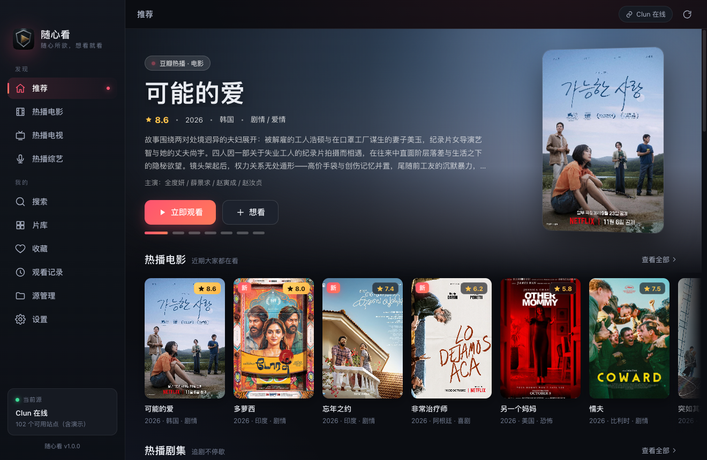
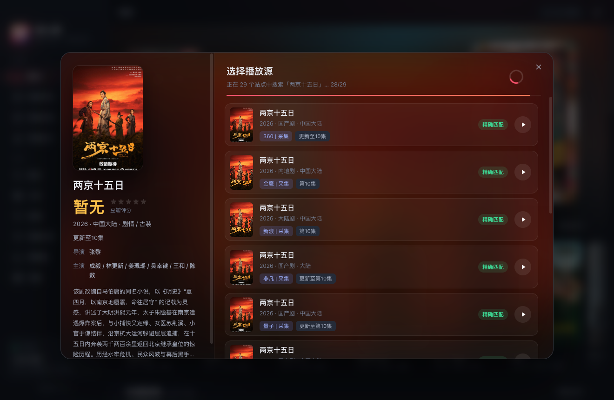
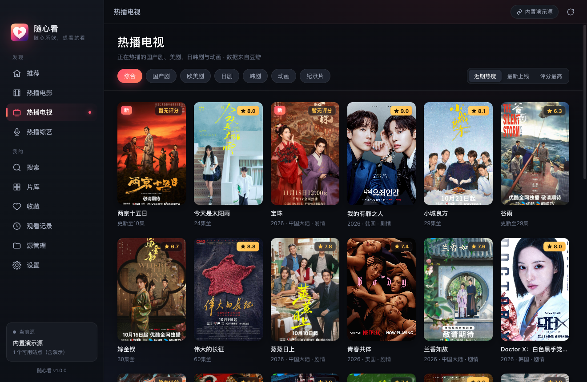
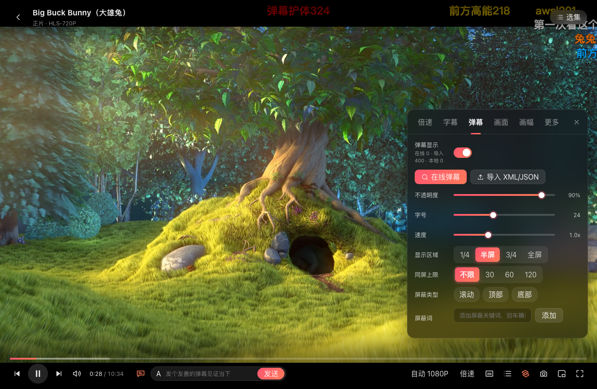
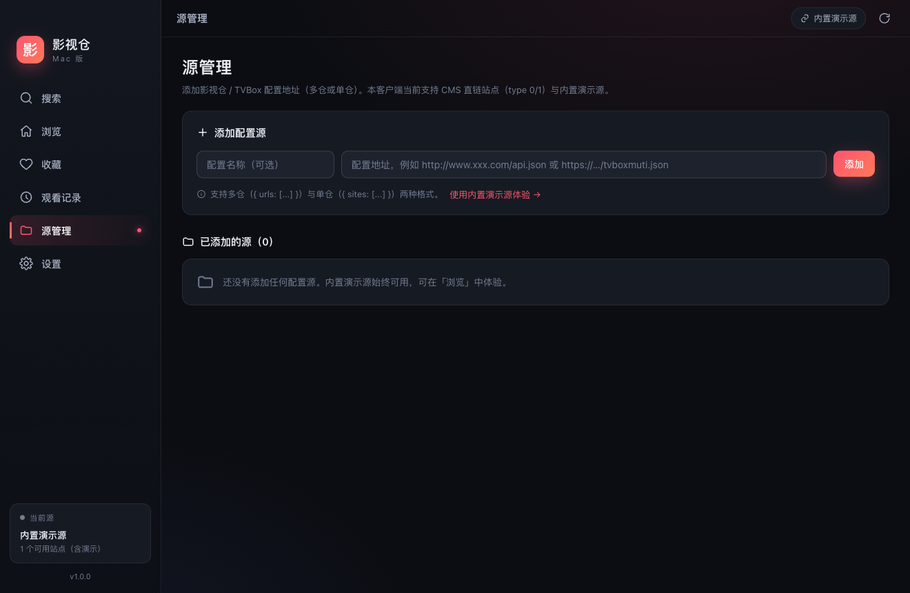

<p align="center"></p>

<h1 align="center">随心看</h1>

<p align="center">
  <a href="LICENSE"></a>
  <a href="https://github.com/laowantong2077/tvbox_mac/releases"></a>
  
  
  
</p>

<p align="center"><b>想看就看，随心所欲 —— 面向 macOS 的 TVBox 配置生态影视客户端。</b></p>

**随心看** 是一个兼容「TVBox / 影视仓」配置生态的 **macOS 影视客户端**，用一套 React 前端 + 一份 Rust 内核实现三大核心功能：**搜索、播放、添加源**。

- 🖥️ **为 macOS 而做**：Tauri 2 + Rust 原生外壳，安装包小巧、启动迅速、内存占用低，原生中文菜单与深色影院风窗口。
- 🔌 **兼容 TVBox 源**：支持 TVBox 多仓（`urls`）与单仓（`sites`）配置，添加源即可浏览、搜索、播放。
- ⚡ **Rust 内核查网**：跨域请求、CMS 适配、HLS 代理、网络分流均由本地 Rust 服务处理，天然规避 CORS 与混合内容限制。

---

## 🙏 致敬与致谢

> 随心看的配置协议与产品形态，源自以 **TVBox** 为代表的开源影视客户端生态。感谢 TVBox 及其衍生项目（影视仓 等）的先行者与社区贡献者——没有这些开源工作，就不会有随心看。本项目谨向这些项目致敬。

随心看**不内置、不分发任何受版权保护的影视内容**，仅作为 TVBox 配置协议的独立 macOS 客户端实现；所有源与内容均由用户自行添加（详见 [免责声明](#-免责声明)）。

- TVBox / 影视仓 生态与使用说明：<https://github.com/noimank/tvbox>
- 影视仓配置分发参考站点：<http://xn--5mqx81b535a.com/web/index.html>

---

## ⬇️ 下载与安装

前往 [**Releases**](https://github.com/laowantong2077/tvbox_mac/releases) 下载最新版本：

| 平台 | 产物 | 说明 |
| --- | --- | --- |
| macOS (Apple Silicon) | `suixinkan_1.0.0_aarch64.dmg` | ad-hoc 签名，macOS 11+，Apple 芯片 |
| Android (arm64) | `suixinkan_1.0.0_aarch64.apk` | 需允许「安装未知来源应用」 |

**macOS 安装**：打开 `suixinkan_1.0.0_aarch64.dmg`，把「随心看」拖进「应用程序」。首次打开若被系统拦截：在「访达」里右键 App →「打开」；或执行：

```bash
xattr -dr com.apple.quarantine /Applications/随心看.app
```

**Android 安装**：下载 `.apk` 传到手机安装，首次需在系统设置中允许「安装未知来源应用」。

> macOS 版当前为 ad-hoc 签名（未走 Apple 公证），首次打开需按上述方式放行；Android 版为自签名 release 包。

---

## ✨ 功能特性

| 模块 | 说明 |
| --- | --- |
| 🏠 推荐首页 | 豆瓣数据驱动：大图 Hero 轮播 + 8 行横向推荐（热播电影 / 剧集 / 综艺 / 高分 / 口碑榜 / 华语剧 / 动漫 / 纪录片） |
| 🔥 热播电影 / 电视 / 综艺 | 标签筛选（热门、最新、高分、华语、欧美、日韩、动画、纪录片…）、排序、无限滚动；豆瓣不可用时自动回退到当前源分类 |
| 🎯 智能选源 | 点击豆瓣条目，并发在全部站点按片名搜索，按相似度 + 年份排序，标注「精确匹配」，一键进入详情/播放 |
| 🔍 聚合搜索 | 并发查询所有可搜索站点，按站点分组、可筛选 |
| 🎬 片库 / 详情 / 选集 | 站点分类浏览；多线路切换 + 分集选择 |
| ▶️ 强化播放器 | **倍速**（0.25–4x，长按 → 3x）、**字幕**（srt/vtt/ass、拖入加载、HLS 内嵌字幕、样式与时间偏移）、**弹幕**（Canvas 引擎、发送、导入 B 站 XML、B 站在线弹幕自动匹配、透明度/区域/密度/屏蔽词）、**画面**（亮度/对比度/饱和度/色相/镜像/翻转/旋转/锐化）、**画幅**（原始/16:9/4:3/21:9/1:1/铺满/裁剪 + 缩放）、清晰度/音轨切换、音量增强至 200%、画中画、截图、跳过片头片尾、统计信息、快捷键面板 |
| 🌐 网络与代理 | 四种模式：**跟随系统 / 直连 / 自定义代理（HTTP·SOCKS5）/ 智能**；网络诊断（通道连通性与测速）；顶栏快捷切换 |
| ➕ 源管理 | 支持 TVBox 多仓（`urls`）与单仓（`sites`）配置 |
| ⭐ 收藏 / 🕘 观看记录 | 收藏网格、观看记录含进度与「继续观看」 |
| 🎁 内置演示源 | 4 部公共测试流，开箱即播 |

### 界面预览

| 推荐首页 | 智能选源 |
| --- | --- |
|  |  |

| 热播电视 | 聚合搜索 |
| --- | --- |
|  |  |

| 播放器 · 弹幕 | 播放器 · 画面 |
| --- | --- |
|  |  |

| 源管理 |
| --- |
|  |

### 播放器快捷键

空格 播放/暂停 ｜ ← → 快退/快进 5 秒 ｜ 长按 → 3 倍速 ｜ ↑ ↓ 音量 ｜ [ ] 减速/加速 ｜ F / 双击 全屏 ｜ M 静音 ｜ D 弹幕开关 ｜ S 截图 ｜ N / P 下一集/上一集 ｜ I 统计信息 ｜ Shift+P 画中画 ｜ ? 快捷键帮助 ｜ Esc 退出 ｜ 滚轮 音量

---

## 🚀 运行方式

### 方式一：安装打包好的 App（推荐）

- **macOS**：从 [Releases](https://github.com/laowantong2077/tvbox_mac/releases) 下载 `suixinkan_1.0.0_aarch64.dmg`，打开后把「随心看」拖进「应用程序」。已做 ad-hoc 签名，首次打开若被拦截：「访达 → 右键 App → 打开」，或 `xattr -dr com.apple.quarantine /Applications/随心看.app`。

### 方式二：源码开发 / 调试

```bash
npm install                 # 安装前端依赖（需要 Rust 1.80+）
npm run build               # 构建前端 → dist/（会被嵌入 Rust 二进制）
npm run core:dev            # 仅启动 Rust 内核服务，浏览器访问 http://127.0.0.1:4174
npm run tauri dev           # 以 Tauri 桌面窗口运行
```

### 方式三：重新打包 macOS

```bash
npx tauri build --target aarch64-apple-darwin --bundles app   # → target/aarch64-apple-darwin/release/bundle/macos/随心看.app
codesign --force --deep --sign - "target/aarch64-apple-darwin/release/bundle/macos/随心看.app"
```

---

## 🧩 如何添加源

1. 进入「源管理」→ 填写名称（可选）与**配置地址** → 点击「添加」。
2. 配置地址支持两种格式：
   - **多仓**：`{"urls":[{"url":"...","name":"..."}]}`，例如
     `https://raw.githubusercontent.com/noimank/tvbox/main/tvboxmuti.json`
   - **单仓**：`{"sites":[...]}`，即 TVBox 标准接口（常见 `api.json`）
3. 添加后点击「启用」切换为当前源；多仓可点「查看仓库」展开并按仓库切换。
4. 「搜索 / 浏览」会使用当前源下的可用站点。

---

## 🏗️ 技术架构

> `src-tauri/` 外壳启动 `core/`（Rust：axum + reqwest + tokio）内嵌服务于 `127.0.0.1` 随机端口，WebView 加载该地址；前端走同源 `/api`，跨域、适配、流代理全部交给 Rust 内核。

```
┌──────────────────────────────┐
│        Tauri 2 外壳           │
│  src-tauri/src/lib.rs        │
│   · 启动内嵌 Rust 服务(随机端口)│
│   · 创建 WebviewWindow        │
└───────────────┬──────────────┘
                │ loadURL(127.0.0.1:port)
┌───────────────▼──────────────┐        ┌──────────────────────────┐
│   React 前端 (Vite 构建)      │  /api  │   Rust 内核 core/ (axum)   │
│  src/…                        │ ─────► │  core/src/server.rs        │
│  · 页面/组件/状态管理          │        │  · 配置解析 config.rs      │
│  · hls.js 播放器              │        │  · CMS 适配 cms/           │
│  · 走同源 /api 规避 CORS       │        │  · 出网 http.rs            │
└──────────────────────────────┘        │  · 流代理 stream/          │
                                         │  · 状态持久化 store.rs     │
                                         └──────────────────────────┘
```

- **出网与 CORS**：前端所有站点请求都发到本地 `/api`，由 Rust 内核发起真实请求，天然规避浏览器跨域与混合内容限制。
- **流代理**：`/api/stream` 转发 m3u8/ts/mp4，自动改写 m3u8 内的子清单/分片/key 地址继续走代理，支持 Range。
- **播放**：Chromium / WKWebView 不原生支持 HLS，使用 **hls.js** 解析 m3u8；MP4/直链直接交给 `<video>`。
- **状态**：`state.json` 原子写入；开发态在项目 `data/`，打包后位于
  `~/Library/Application Support/随心看/data/state.json`。

### 目录结构

```
tvbox_mac/
├─ core/                     # Rust 内核（axum 服务 + 出网/适配/流代理/持久化）
│  └─ src/
│     ├─ server.rs           # HTTP 服务与 /api/* 路由
│     ├─ http.rs             # 出网请求（重定向/gzip/gbk/容错证书）
│     ├─ cms/                # 苹果CMS(type0/1) 适配
│     ├─ config.rs           # 多仓/单仓配置解析与站点规范化
│     ├─ stream/             # m3u8 改写与流代理
│     └─ store.rs            # 本地状态读写
├─ src-tauri/                # Tauri 2 外壳（窗口、菜单、启动内嵌服务）
├─ src/
│  ├─ pages/                 # 搜索/浏览/详情/收藏/记录/源管理/设置
│  ├─ components/            # Sidebar/TopBar/Player/VideoCard/Poster/Icon/Toasts/Logo
│  ├─ lib/                   # api.ts / store.tsx / nav.tsx
│  └─ styles.css             # 深色影院风设计系统
├─ public/                   # logo.svg / favicon.png
└─ docs/screenshots/         # 界面截图
```

---

## ⚠️ 已知限制

- **站点类型支持**：当前完整支持 **type 0 / type 1（苹果CMS XML/JSON）** 与内置演示源（type 100）。
  **type 3（JS 爬虫 / drpy / catvod）** 需要专用 JS 运行时，暂未内置，界面会标注「暂不支持」。
- **地域限制**：部分 CDN 对海外出口返回 403。请使用「直连 / 智能」网络模式；若本身身处海外（无国内物理网络），需配置一个国内的 HTTP/SOCKS5 代理。
- **在线弹幕**：目前接入 B 站（弹弹play 需要 AppId 签名、部分公共弹幕接口已失效）；B 站无版权的影片可能搜不到，可导入本地 XML 或自己发送。
- **签名与公证**：macOS 为 ad-hoc 签名（首次打开需手动放行）；如需面向公众无感分发，建议使用 Apple 开发者账号做 Developer ID 签名与公证。

---

## 📱 其他平台（实验性）

除 macOS 主平台外，代码库也保留 Android / iOS 的 Tauri 构建配置，可自行编译体验，但**非主要支持目标**、稳定性和体验以 macOS 为准：

```bash
# Android（需 Android SDK 36 + NDK 27 + JDK 17+）
export ANDROID_HOME=~/Library/Android/sdk NDK_HOME=$ANDROID_HOME/ndk/27.1.12297006
npx tauri android build --apk --target aarch64

# iOS（需 Xcode；无开发者账号时只能出模拟器包 / 未签名 IPA）
npx tauri ios build --target aarch64-sim --no-sign
```

- 窄屏 / 触屏自动切换移动布局：底部标签栏、3 列海报网格、底部抽屉式选源；播放器支持手势操作。
- iOS / Android 无法像桌面那样绑定物理网卡，「直连」模式受限，请在系统网络设置中把视频 CDN 放行。

---

## 📄 免责声明

> 本项目仅作为 **TVBox 配置协议的客户端实现演示**，**不内置、不提供、不分发任何受版权保护的影视内容**。应用内展示、搜索、播放的所有内容与源，均由用户**自行添加与访问**，与本项目作者无关。请在遵守当地法律法规的前提下，仅将本软件用于访问你有权访问的内容。因使用本软件产生的任何法律责任由使用者自行承担。

---

## 🤝 贡献

欢迎提交 Issue 与 Pull Request。提交前请先阅读 [CONTRIBUTING.md](CONTRIBUTING.md)；参与本项目即表示你同意遵守 [CODE_OF_CONDUCT.md](CODE_OF_CONDUCT.md)。安全问题请按 [SECURITY.md](SECURITY.md) 的方式私下反馈，请勿公开提交漏洞细节。

---

## 📜 License

本项目基于 [MIT License](LICENSE) 开源，Copyright © 2025 随心看。

---

## 📝 更新日志

### v1.0.0

- 🎉 **随心看 1.0.0 首次发布** —— 面向 macOS 的 TVBox 配置生态影视客户端。
- 🖥️ 基于 **Tauri 2 + Rust** 的 macOS 原生桌面外壳：安装包小巧、启动快、内存占用低，原生中文菜单与深色影院风窗口。
- 🔍 三大核心：**搜索、播放、添加源**；支持 TVBox 多仓（`urls`）与单仓（`sites`）配置。
- 🏠 豆瓣数据驱动首页：Hero 轮播 + 多行横向推荐；热播电影 / 电视 / 综艺分类；智能选源按相似度 + 年份排序。
- ▶️ 强化播放器：倍速、字幕、弹幕（含 B 站导入/在线匹配）、画面调节、画幅、清晰度/音轨、音量增强、画中画、截图、跳过片头片尾、快捷键面板。
- 🌐 网络与代理：跟随系统 / 直连 / 自定义代理 / 智能四模式，网络诊断。
- ⭐ 收藏与观看记录、内置 4 部公共测试流演示源，开箱即播。
- 📱 附带 Android / iOS 构建配置（实验性，以 macOS 为主平台）。
